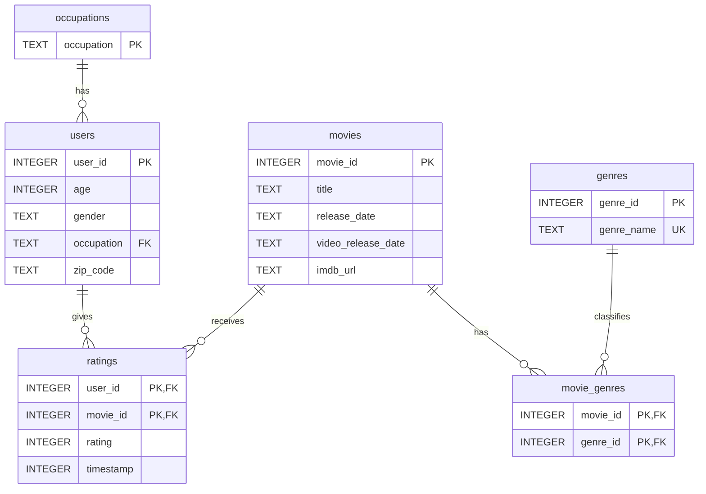

# Homework 3

## Team Members
- Smith Elie
- Padma Bellamkonda
- Christoph Dittrich

## Provenance
- **Source URL**: https://files.grouplens.org/datasets/movielens/ml-100k.zip
- **Download Date**: 10/27/2026
- **SHA256 hash**: 50d2a982c66986937beb9ffb3aa76efe955bf3d5c6b761f4e3a7cd717c6a3229

## Setup

Install dependencies:
```
pip install -r requirements.txt
```

Download and extract the dataset:
```
python src/download.py
```


## Database Schema

The MovieLens 100K dataset is stored in six normalized tables.



