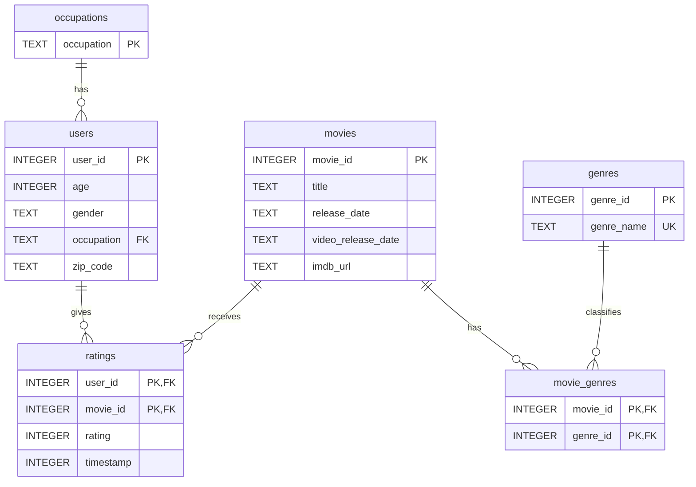

# Homework 3

## Team Members
- Smith Elie
- Padma Bellamkonda
- Christoph Dittrich

## Provenance
- **Source URL**: https://files.grouplens.org/datasets/movielens/ml-100k.zip
- **Download Date**: 10/27/2026
- **SHA256 hash**: 50d2a982c66986937beb9ffb3aa76efe955bf3d5c6b761f4e3a7cd717c6a3229

## Setup

Install dependencies:

```bash
pip install -r requirements.txt
```

Run the complete pipeline:

```bash
make
```

This downloads and extracts the MovieLens 100K dataset, rebuilds
the SQLite database, and generates the query results.

Generated files:
- `data/movielens.db` — SQLite database
- `output/rejected.csv` — rejected records and SQLite errors
- `output/queries/` — SQL query results
- `figures/` — exploratory charts


## Database Schema

The MovieLens 100K dataset is stored in six normalized tables.




## Contributions

- **Smith:** Completed Steps 0, 1, 2 (with contributions from everyone), and Step 5. Extended the Step 3 Makefile to automatically execute all SQL queries and save their results.
- **Smith and Chris:** Step 8 (Split up)
- **Chris and Padma:** Worked on Step 3.
- **Padma:** Completed Steps 4 and 7.
- **Chris:** Completed Step 6 and contributed to Step 8.
- **Everyone:** Contributed to Step 2, Step 3 and the write-up.

## AI-Note
We used AI as a supporting tool to validate SQL query syntax and assist with debugging and troubleshooting. All final code, queries and results were reviewed and tested by the team.
