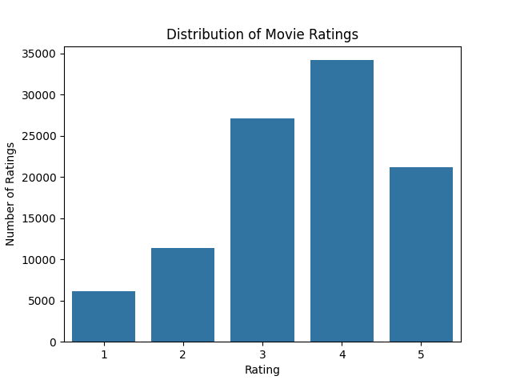
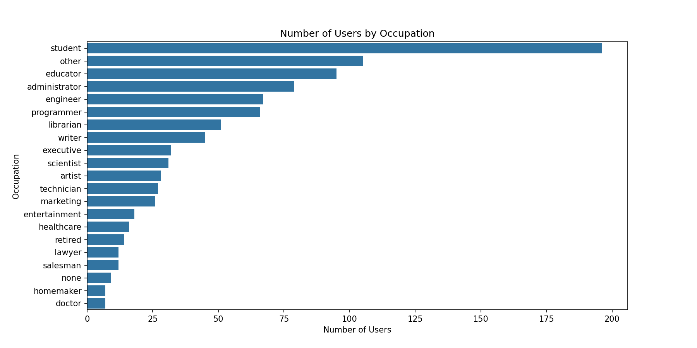

# Homework 3 — Writeup

## Step 0 — Describe the Raw Data

### u.user

For the u.user dataset, the shape is (943, 5) and each row represents a user and the data is tidy. 
The README leaves out the fact that the zip code should be loaded as a string to preserve leading zeros.
The README does not specify types. The README incorrectly states that the data is tab delimited when, in fact, it is pipe delimited.

### u.item

For the u.item dataset, the shape is (1682, 24). Each row represents a movie and the data is not tidy because the 
values of what should be genre are represented as their own individual columns. The README incorrectly states that the data is tab delimited when, in fact, it is pipe delimited. The README also left out the fact that the encoding used is Latin-1. The README does not specify types. There are also missing values across release date, video release date and IMDb URL.

### u.data

For the u.data dataset, the shape is (100000, 4). Each row represents a user rating for a movie. The data is tidy. The README does not specify types beyond the timestamp being epoch time.

### Chart 1 — Distribution of Ratings

This chart shows us the distribution of movie ratings.
This chart suggests that ratings are skewed positively. It may be worth investigating if any groups are driving this.

### Chart 2 — Number of Users by Occupation

This chart shows the distribution of MovieLens users across occupations.
It can answer questions around if any particular group is overrepresented in the data. In this case, students are.

## Step 2 — Describe the Raw Data

### 2(a) - The six-table SQLite schema is documented in the [Database Schema](README.md#database-schema) section of the README.

### 2(b) - The original u.item file represents genres using 19 binary columns, with each column indicating whether a movie belongs to a particular genre.
I normalized this representation into two tables: genres, which stores the genre IDs and names, and movie_genres, which stores one row per movie–genre association. This allows a movie to belong to multiple genres without requiring a separate column for each genre.
This design is tidy because each row represents a single movie-genre association. It also avoids hardcoding the 19 genres into the table structure. The composite primary key (movie_id, genre_id) prevents duplicate associations, while foreign keys ensure that each association references an existing movie and genre.

### 2(c) - Constraints and Validation
The schema uses STRICT tables, primary and foreign keys, NOT NULL, UNIQUE and CHECK constraints to enforce the following:
- Valid ratings (1–5), positive ages and timestamps, and gender codes (M/F).
- Nonblank movie titles, ZIP codes and genre names.
- Unique IDs, genre names, user–movie rating pairs and movie–genre pairs.
- Valid references between users, occupations, movies, ratings and genres.

**Claims requiring separate validation:**
- Dataset counts: 943 users, 1,682 movies, and 100,000 ratings (COUNT(*)).
- At least 20 ratings per user (GROUP BY and HAVING).
- Complete and accurate loading of source records (compare source and database counts).

### 2(d) - I chose TEXT for zip because ZIP codes are identifiers rather than numerical values.
Storing them as numerical values may lead to leading zeros getting dropped. Using TEXT
preserves the source data as it existed in the raw data files.

## Step 3 — Load the data and keep what is refused

### 3a. Predictions (written before running `make`)

| Table | Expected rows | Source of the expectation |
|---|---|---|
| occupations | 21 | the 21 values listed in the README (`u.occupation`) |
| genres | 19 | the 19 genres in `u.genre` |
| users | 943 | README: 943 users |
| movies | 1,682 | README: 1,682 movies |
| movie_genres | not known in advance | one row per genre flag set to 1, so at least 1,682 if every movie has a genre |
| ratings | 100,000 | README: 100,000 ratings |

**Expected refusals:** none.

### 3e. Actual row counts vs. predictions

| Table | Predicted | Actual | Difference |
|---|---|---|---|
| occupations | 21 | 21 | none |
| genres | 19 | 19 | none |
| users | 943 | 943 | none |
| movies | 1,682 | 1,682 | none |
| movie_genres | unknown | 2,893 | not predictable in advance; higher than 1,682 because many movies belong to more than one genre |
| ratings | 100,000 | 100,000 | none |
| Rejected rows | 0 | 0 | none |

Every count matched the prediction and none of the rows were refused. However, there is one date `4-Feb-1971` with no leading zero. `load.py` converts every date to the ISO format (`1995-01-01`) so dates sort and are compared correctly in SQL.
